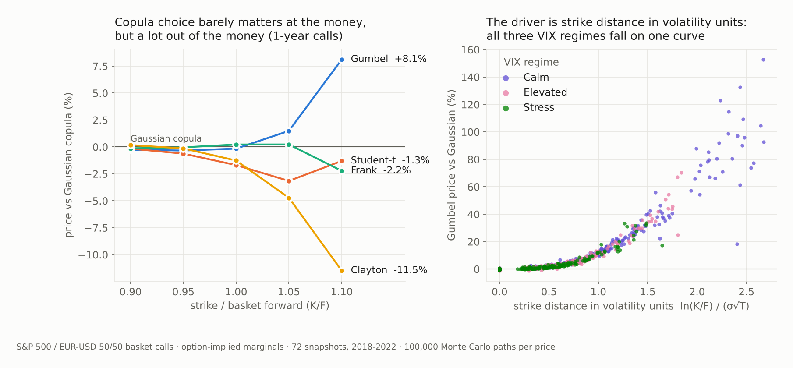

# Dependence Modelling in Multi-Asset Derivatives Pricing

**How much does the choice of copula change the price of an equity-FX basket option?**

[](https://colab.research.google.com/github/mariglen-tanushi/equity-fx_derivatives-pricing/blob/main/thesis_pipeline.ipynb)

[](LICENSE)

MSc thesis in Banking and Finance, Università Cattolica del Sacro Cuore (A.Y. 2025/2026). The study prices 50/50 basket calls on the S&P 500 and EUR/USD:
- each marginal distribution comes from that asset's own implied volatility surface;
- only the dependence structure changes: Gaussian, Frank, Clayton, Gumbel and Student-t copulas.

<picture>
  <source media="(prefers-color-scheme: dark)" srcset="docs/img/key_results_dark.png">
  
</picture>

## Key results

| | |
|---|---|
| **Sample** | 1,258 paired daily log-returns (2018-2022): Pearson ρ = 0.176, Kendall τ = 0.141 |
| **Best fit** | Student-t overall. Among the single-parameter families, Gumbel (δ = 1.179, upper-tail dependence 0.20, AIC 32.6 below Gaussian) |
| **At the money** | Copula choice moves the price by less than 2% at every maturity |
| **Out of the money** | At 1Y and K/F = 1.10: Gumbel +8.1%, Clayton −11.5% vs Gaussian |
| **Regimes** | Gumbel-Frank gap ≈ 17 pts in calm markets vs ≈ 4 pts under stress for a fixed strike fraction |
| **Driver** | Distance of the strike from the forward in volatility units: with standardised moneyness the regime adds almost nothing (R² 0.06 → 0.93) |

The practical implication: copula model risk on out-of-the-money basket products should be sized by strike distance in volatility units, not by the market regime.

## Method

```
SPX option chains ──► Black-Scholes IV (Brent) ──┐
EUR/USD OTC quotes ──► delta-to-strike smiles ───┼──► SVI per maturity ──► Breeden-Litzenberger marginals ──┐
FRED / ECB rates, parity dividend yield ─────────┘                                                         │
                                                                                                            ├──► Monte Carlo basket pricing
SPX & EUR/USD daily returns ──► pseudo-observations ──► copula calibration (5 families, robustness) ────────┘
```

1. **Implied volatility.** Implied volatility estimates for the filtered SPX option chains (optionsDX) are generated using Brent's algorithm, where the interest rate is identified at each date, and the dividend yield used in this model is obtained from put-call parity. Smiles in EUR/USD are estimated from the ATM volatility and the 25Δ and 10Δ risk reversals and butterflies quoted in LSEG OTC quotes, using the forward delta convention.
2. **Marginal distributions.** Marginal distributions are generated using the SVI model, with each time-to-maturity being penalised for violation of the butterfly condition, the calendar condition and the Lee bound; further, risk-neutral distribution functions can be derived from the Breeden-Litzenberger relation; additionally, a lognormal marginal function with a flat smile is maintained as a reference model.
3. **Dependence.** Dependence models are fitted using canonical maximum likelihood on rank pseudo-observations based on the whole sample, as well as on samples divided into VIX regimes. In addition, robustness tests have been performed:
   - use of an AR(1)-GARCH(1,1)-t filter for observations
   - evaluation of the Cramér-von Mises statistic and goodness of fit using a parametric bootstrap
   - fitting of survival, BB7 and symmetrised Joe-Clayton copulas
   - a split-sample comparison of the performance of copula models in an out-of-sample setting
4. **Pricing.** All prices were computed using 100,000 Monte Carlo simulations. The uniform variables that drive the Monte Carlo simulation were sampled antithetically, and all the copulas share the same random numbers. Therefore, there exists a unique standard error for each copula-minus-Gaussian difference. The grid contains 72 snapshots × 4 maturities × 5 strikes × 5 copulas = 7,200 prices; these prices were simulated under four different sets of copula parameters and two sets of marginal specifications, resulting in 7,200 × 4 × 2 = 57,600 prices.
5. **Verification.** Additional verification was carried out:
   - validation of the sampler regarding joint tail frequency
   - experiments related to convergence and variance reduction
   - evaluation of model-free Fréchet price bounds
   - dependence premium stress testing for the usage of a historical copula with risk-neutral marginals

## Repository structure

```
├── thesis_pipeline.ipynb       Full pipeline (Google Colab), Sections 1-10
├── outputs/
│   ├── results_full.json       Every number reported in the thesis
│   ├── tables/                 Result tables (Chapter 5 and Appendix A)
│   ├── figures/                Thesis figures 4.1-4.5 and 5.1-5.10
│   └── model/                  Calibration, robustness, sampler, convergence and price-bound outputs
├── docs/
│   ├── data_requirements.md    Data sources and expected folder layout
│   └── img/                    README figures
├── requirements.txt
├── CITATION.cff
└── LICENSE
```

| Notebook section | Content |
|---|---|
| 1 | Setup, paths, 74 target snapshot dates (60 month-ends + 14 stress-event dates) |
| 2 | SPX option chains, rates, parity dividend yield, implied volatility inversion |
| 3-4 | SPX volatility surfaces; Cboe VIX close |
| 5-7 | Public market data; EUR/USD spot, paired returns and volatility surfaces |
| 8 | Copula calibration and robustness |
| 9 | SVI marginals, Monte Carlo pricing, sampler and convergence checks, price bounds, design sensitivity |
| 10 | Tables, figures and `results_full.json` |

## Data

The SPX option chains (optionsDX) and EUR/USD volatility and spot data (LSEG REFINITIV) are licensed and not included. Public series (FRED, ECB Data Portal, Cboe) are listed in [`docs/data_requirements.md`](docs/data_requirements.md).

## Reproducing the results

1. Open `thesis_pipeline.ipynb` in Google Colab.
2. Place the raw files in `Raw_Data/`. By default the notebook mounts Google Drive and works in `Colab Notebooks/`; to run from another folder, set the environment variable `THESIS_ROOT` to the folder that contains `Raw_Data/`.
3. Run all cells. A full run takes about 75-105 minutes; intermediate files are written to `thesis_processed/`, so Section 10 can be rerun on its own in about 2 minutes.

All random draws are seeded, so the outputs in `outputs/` are reproduced exactly from the same inputs.

## Citation

> Tanushi, M. (2026). *Dependence Modelling in Multi-Asset Derivatives Pricing: An Empirical Analysis of Linear Correlation versus Copula-Based Approaches for Equity-FX Basket Option Pricing*. MSc thesis, Università Cattolica del Sacro Cuore, Milan.

## License

[MIT](LICENSE)
